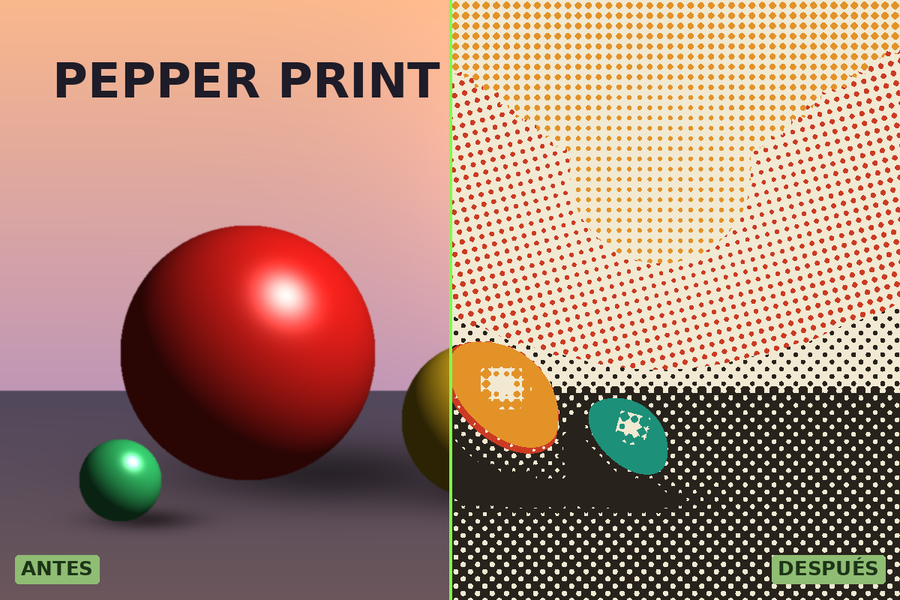
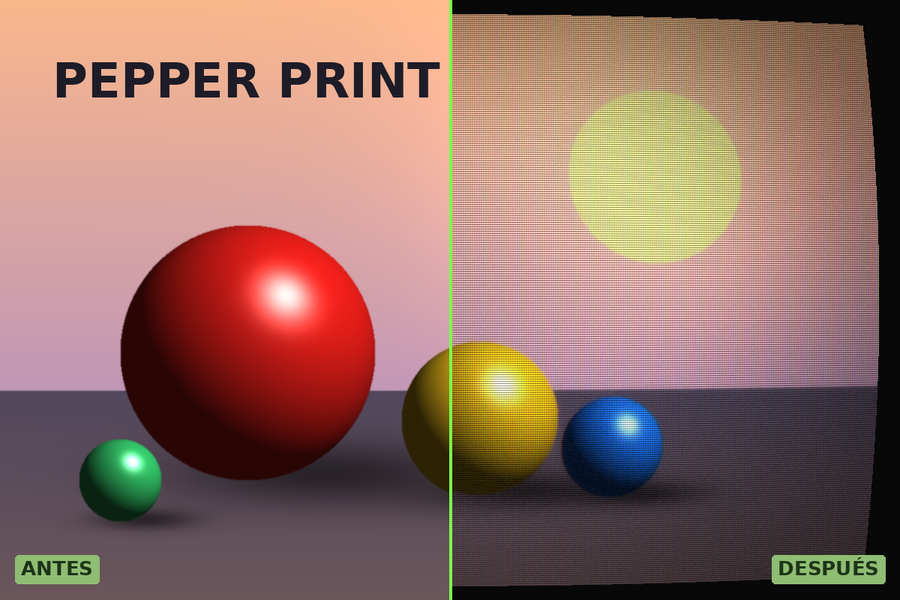
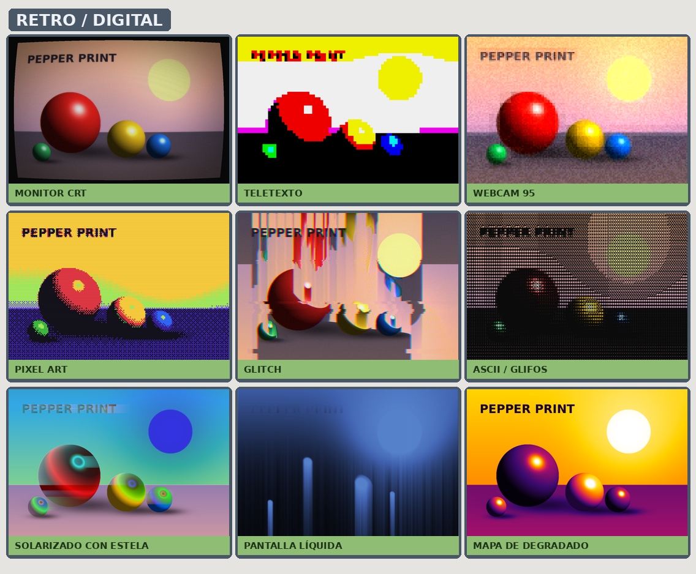
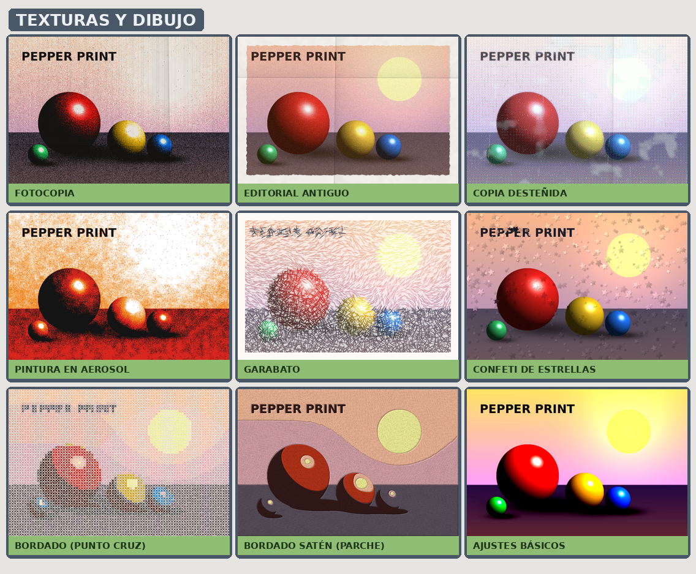
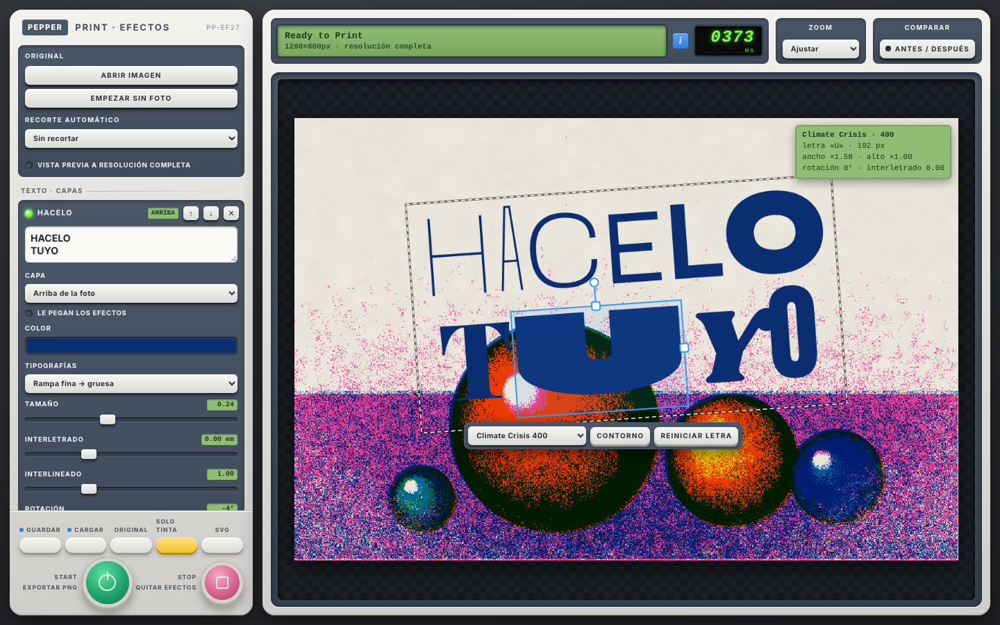

# Pepper Print · Efectos

**27 efectos de imagen y arte con texto para serigrafía, DTF, risografía y diseño gráfico — gratis, en el navegador y sin subir nada a internet.**

### ▶ [Abrir la web](https://pepperprint.github.io/pepper-efectos/)


Hecha por [Pepper Print](https://github.com/PepperPrint) para el trabajo diario del taller: preparar diseños para DTF, sacar looks de serigrafía y risografía, y probar estilos en segundos sin abrir Photoshop.

---

## Qué tiene de bueno

- **Sin instalar nada.** Es un solo archivo HTML. Abrís el link o el archivo con doble clic y listo, en Mac o Windows.
- **Tus imágenes no salen de tu computadora.** Todo se procesa en tu navegador; no hay servidor ni cuentas.
- **Efectos que se combinan como capas.** Apilás varios, los reordenás y cada uno tiene **modo de fusión** (los mismos 16 de Photoshop: Multiplicar, Trama, Superponer…) y **opacidad**.
- **Listo para producción.** Exporta PNG a resolución completa, y con **Solo tinta** el fondo sale transparente — ideal para DTF y serigrafía.
- **Recorte automático.** Al abrir una foto podés elegir *Recortar silueta* (quita el fondo y deja a la persona) o *Recortar cabeza*. Corre en tu navegador: la primera vez baja el modelo (~16 MB) y la foto no sale de tu computadora.
- **Arte con texto.** Sumá frases arriba o abajo de tu foto, con una tipografía distinta en cada letra. Estirás, rotás o pasás a contorno cualquier letra tocándola.
- **Vista antes / después** con un divisor que arrastrás sobre la imagen.

## Antes y después

| Risografía | Halftone (serigrafía) | Monitor CRT |
|---|---|---|
|  |  |  |

## Los 27 efectos






| Impresión | Retro / digital | Texturas y dibujo |
|---|---|---|
| **Retro Print** — una tinta con grano y reticulación | **Monitor CRT** — líneas, máscara RGB, curvatura; fósforo verde/ámbar y "fantasma" | **Fotocopia** — tóner, grano, negros planos y pliegues |
| **Halftone (DTF / serigrafía)** — AM/FM, 6 formas de punto, tintas planas, CMYK, desregistro | **Teletexto** — mosaico 2×3 con 8 colores | **Editorial antiguo** — tono de película, gradación y borde recortado |
| **Risografía** — separación en 1–3 tintas con superposición real | **Webcam 95** — baja resolución y compresión en bloques | **Copia desteñida** — brillo difuso, grunge y trama de color |
| **Stipple** — puntillado con ruido + umbral | **Pixel art** — paletas Game Boy, PICO-8, CGA… | **Pintura en aerosol** — grano de spray y salpicaduras |
| **Silueta en semitono** — puntos que se desvanecen (logos) | **Glitch** — pixel sorting, franjas y RGB | **Garabato** — trazos de lápiz de color |
| **Ticket escaneado** — térmica a 2 colores, movimiento, bordes rasgados | **ASCII / glifos** | **Confeti de estrellas** |
| **Stencil** — 2 o 3 tonos planos | **Solarizado con estela** | **Bordado punto cruz** |
| **Grabado de líneas** | **Pantalla líquida** | **Bordado satén (parche)** |
| **Posterizar** | **Mapa de degradado** — térmico, neón, duotono… | **Ajustes básicos** |

## Arte con texto



Tocá **+ Agregar texto** (o **Empezar sin foto** para arrancar con un lienzo en blanco) y escribí tu frase.

- **Arriba o abajo de la foto.** El texto puede ir encima de la imagen o detrás. Tip: con *Recortar silueta* la persona queda adelante y la frase gigante atrás, como en un póster.
- **Le pegan los efectos.** Con la casilla prendida, el texto pasa por los efectos junto con la foto (como si se imprimiera todo junto). Apagada, queda limpio y nítido. Se elige en cada capa.
- **Tipografías mezcladas.** Cada letra sale de una tipografía distinta según el reparto: *Parejo, Extremos, Tirando a pesado / liviano, Ola, Rampa fina → gruesa, Rampa por línea, Alternado* o *Una sola*. **Mezclar** la rearma al azar.
- **Tocá una letra** y aparecen sus tiradores: ancho (las vecinas se corren para hacerle lugar), alto y rotación. Abajo tenés su tipografía, **Contorno** y **Reiniciar letra**; arriba a la derecha, su ficha.
- **Arrastrá el texto** para moverlo. Mientras arrastrás se ve sin efectos; al soltar se aplican.
- **SVG** exporta el texto limpio como contornos (una forma por letra), listo para Illustrator, plotter de vinilo o DTF. La parte con efectos va como imagen.

## Para DTF: adiós a las semitransparencias

El DTF no imprime bien sombras suaves ni bordes difuminados: el blanco y el adhesivo no saben qué hacer con un píxel al 40 %. El efecto **Halftone** en modo **DTF** convierte todo lo semitransparente en puntos sólidos, conservando los colores del diseño.


1. Cargá tu PNG con fondo transparente.
2. Agregá **Halftone (DTF / serigrafía)** en modo **DTF** → *Transparencias y sombras suaves*.
3. Ajustá **Lineatura** (25–45 LPI a 300 DPI es lo usual) y **Punto mínimo**.
4. Exportá con la tecla amarilla **Solo tinta**.

También puede **quitar el color de la remera** (los píxeles parecidos al color de la prenda pasan a puntos) o volver transparente lo oscuro o lo claro.

## Cómo se usa

1. Abrí la [web](https://pepperprint.github.io/pepper-efectos/) (o descargá el repo y abrí `index.html` con doble clic).
2. Arrastrá una imagen, pegala con **Ctrl/Cmd + V** o tocá **Abrir imagen**.
3. Elegí un efecto en **Agregar efecto**. Se aplican de arriba hacia abajo.
4. Ajustá los controles. Doble clic en un deslizador lo vuelve al valor original.
5. **START** (botón verde) exporta el PNG. **Solo tinta** (amarillo) lo exporta con fondo transparente.

| Control | Qué hace |
|---|---|
| LED de cada efecto | Lo prende o apaga |
| ↑ ↓ | Cambia el orden |
| ⟲ | Vuelve el efecto a sus valores originales |
| Modo de fusión / Opacidad | Cómo se mezcla con lo que tiene arriba |
| **Original** (mantener) | Muestra la imagen sin efectos |
| **Antes / Después** o tecla **C** | Divisor para comparar |
| **Guardar / Cargar** | Guarda tus efectos y textos en un `.json` |
| **SVG** | Exporta el arte con el texto limpio en contornos |
| **Esc** | Deselecciona el texto |
| **STOP** (dos toques) | Quita todos los efectos |

**Combinaciones que funcionan bien**
- *Confeti de estrellas* + *Risografía* debajo → el look "star confetti".
- *Editorial antiguo* + *Fotocopia* en **Multiplicar 50 %** → revista vieja fotocopiada.
- *Mapa de degradado* (térmico rosa/verde) con ruido → "thermal noise".

## Cómo funciona por dentro

- Un `index.html` con HTML, CSS y JavaScript. Para el texto suma `lib/opentype.js` (lee las tipografías) y `fonts/fonts.js` (las tipografías embebidas). No hace falta instalar nada.
- Las letras se dibujan desde el contorno de cada tipografía, así la pantalla, el PNG y el SVG salen iguales.
- La vista previa trabaja sobre una copia reducida de la imagen (máx. 1600 px) para que los controles respondan rápido; al exportar se procesa a **resolución completa**. Si querés ver el detalle exacto, activá *Vista previa a resolución completa*.
- Cada efecto recibe los píxeles, los transforma y devuelve el resultado; el siguiente efecto trabaja sobre eso, mezclado con el modo de fusión elegido.
- La última configuración queda guardada en tu navegador.

## Sumar una tipografía

Las tipografías están en `fonts/fonts.js`, generado por `tools/build-fonts.mjs` (las instrucciones están arriba de ese archivo). Tienen que ser de licencia libre; las licencias quedan en `fonts/licencias/`.

Incluidas: Anton, Bebas Neue, Archivo Black, Archivo, Big Shoulders Display, Fraunces, Playfair Display, Instrument Serif, Space Grotesk, Syne, Unbounded, Rubik Mono One, Shrikhand, DM Serif Display, Climate Crisis e Inter — todas con licencia SIL Open Font License.

## Pruebas

```
pip install -r requirements-dev.txt
python -m pytest tests -q
```

Abren la web en Chrome y prueban los efectos, las capas de texto, la edición de letras y la exportación.

## Sumar un efecto nuevo

Dentro de `index.html`, en la sección **EFECTOS**, hay un molde comentado. Cada efecto es un bloque:

```js
registerEffect({
  id: 'mi-efecto',
  name: 'Mi efecto',
  params: [
    { key: 'fuerza', label: 'Fuerza', type: 'range', min: 0, max: 1, step: 0.01, default: 0.5 },
    { key: 'color',  label: 'Color',  type: 'color', default: '#ff0000' },
  ],
  apply(img, p, ctx) {
    // img.data tiene los píxeles RGBA; modificalos y devolvé img
    return img;
  }
});
```

Los controles del panel se arman solos a partir de `params`, y el efecto aparece en el menú con modo de fusión y opacidad incluidos.

---

Hecho por **Pepper Print**. Los ejemplos de este README usan una imagen generada por código.
